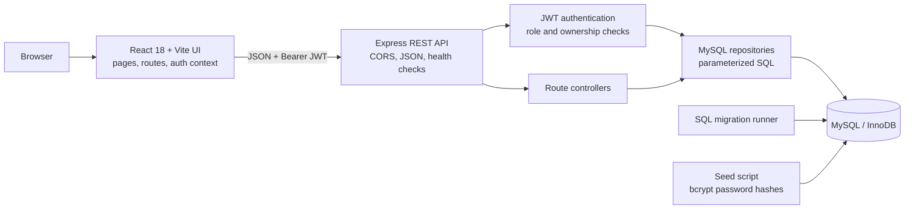
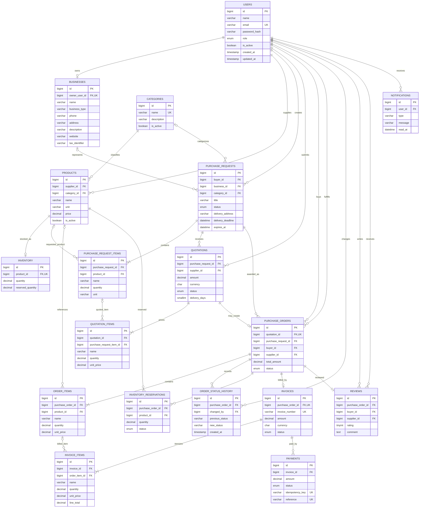
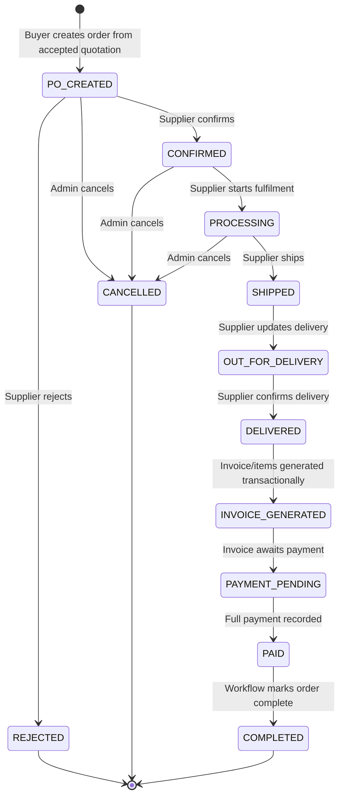

# ProcureHub architecture and data model

## Application architecture

The browser UI is in `frontend/src/`. The backend starts in `backend/src/server.js`, mounts Express route modules, authenticates protected requests, and delegates persistence to repositories under `backend/src/repositories/`. Database settings and the MySQL connection pool are in `backend/src/config/db.js`. Ordered schema changes live under `backend/src/db/migrations/`; the migration runner tracks applied file names in `schema_migrations`.

The backend rejects browser origins outside its configured allow-list. Development permits `localhost:5173` and `127.0.0.1:5173`; production requires explicit HTTPS origins. Authentication uses signed JWT bearer tokens. Role checks and row ownership checks are enforced on the API rather than relying on frontend navigation.

## Database entity relationships

This diagram summarizes the two SQL migrations. Foreign keys and unique constraints are defined in the migrations; nullable relationships reflect optional product links and optional invoice/order-item links.

`schema_migrations` is created and maintained by the migration runner; it is operational metadata rather than a procurement entity. With both migrations applied, the database contains 19 tables including that migration ledger.

## Purchase-order lifecycle

On order creation, inventory represented by catalogue products is reserved within the order transaction. Rejection or permitted cancellation releases reservations; delivery commits them by reducing stock and creates the invoice. The payment action records a manually confirmed development payment; it is not connected to a payment processor.
